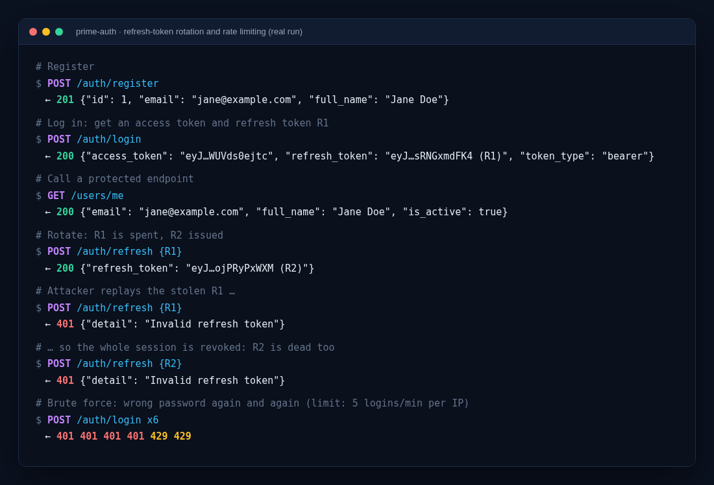
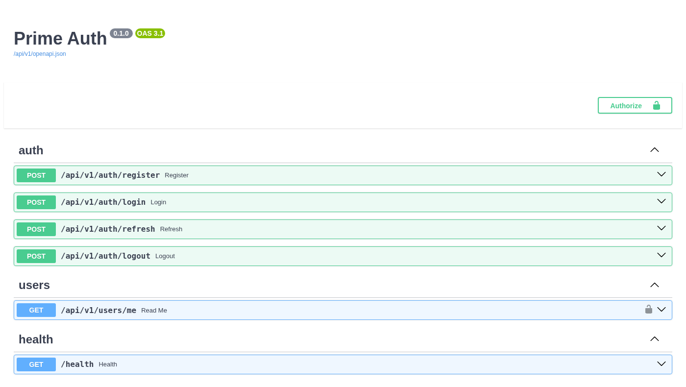
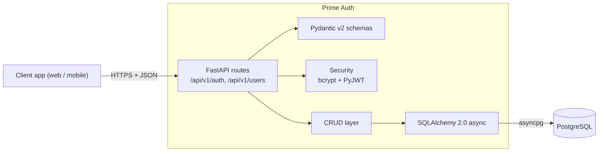
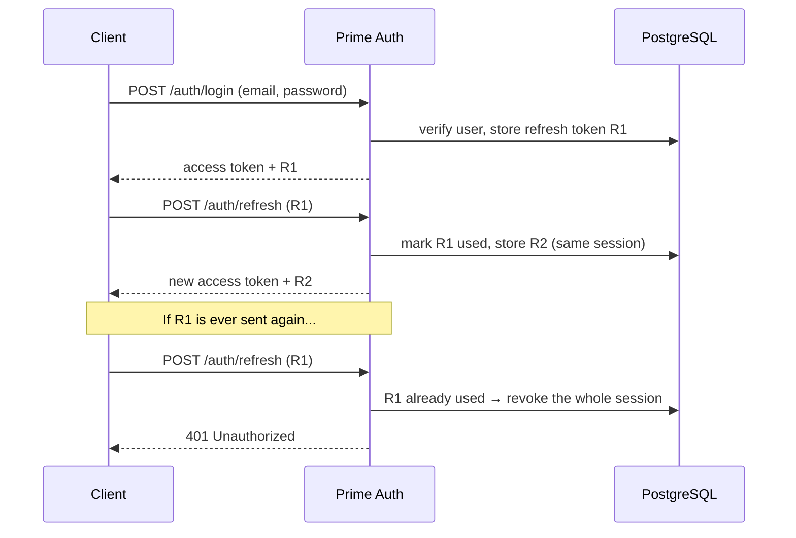

# Prime Auth

[](https://github.com/pruthvi300/prime-auth/actions/workflows/ci.yml)


An asynchronous authentication service built with **FastAPI**, **SQLAlchemy 2.0 (async)** and **PostgreSQL**. It handles registration, login, JWT access/refresh tokens with rotation and reuse detection, logout, and rate limiting, and can be used as the identity backend for a web or mobile app.

## Features

- **JWT access + refresh tokens**: 15-minute access tokens and 7-day refresh tokens. Each token carries a `type` claim, so a refresh token can't be used as an access token or the other way round.
- **Refresh token rotation with reuse detection**: every refresh token works once. If an old one is replayed, the whole login session it belongs to is revoked.
- **Bcrypt password hashing** (cost 12) with a timing-safe login, so response time doesn't reveal which emails are registered.
- **Rate limiting** on login and registration with slowapi.
- **Strict input validation** with Pydantic v2: email format, 8–72 byte passwords, and no client-controlled fields such as `is_active`.
- **Fully async** request handling, from FastAPI down to the asyncpg driver, with a configurable connection pool.
- **Alembic migrations**, applied automatically when the container starts.
- **CI** on GitHub Actions: ruff, pytest with coverage, and a migration drift check against a real PostgreSQL.

## Screenshots

**Token theft, caught.** A real run against the service: a replayed refresh token revokes the whole session, and repeated bad logins are rate-limited.



**Interactive API docs** at `/docs` (Swagger UI)



## Architecture



### Refresh token rotation



More detail on the design choices is in [docs/DESIGN.md](docs/DESIGN.md).

## Tech stack

| Layer | Technology |
|-------|------------|
| API framework | FastAPI, Uvicorn |
| Database | PostgreSQL 16 |
| ORM and migrations | SQLAlchemy 2.0 (async), asyncpg, Alembic |
| Validation and settings | Pydantic v2, pydantic-settings |
| Auth | PyJWT, bcrypt |
| Rate limiting | slowapi |
| Testing and linting | pytest, pytest-asyncio, httpx, ruff |
| Infrastructure | Docker, Docker Compose, GitHub Actions |

## Project structure

```text
prime_auth/
├── app/
│   ├── api/v1/endpoints/   # auth and users routes
│   ├── core/               # settings, security helpers, rate limiter
│   ├── crud/               # database access for users and refresh tokens
│   ├── db/                 # engine, session, declarative base
│   ├── models/             # SQLAlchemy models
│   ├── schemas/            # Pydantic request/response models
│   └── main.py             # FastAPI app
├── alembic/                # database migrations
├── tests/                  # API tests (in-memory SQLite)
├── docs/DESIGN.md          # design notes
├── docker-compose.yml
├── Dockerfile
└── Makefile
```

## Getting started

### Option 1: Docker (recommended)

Requires Docker and Docker Compose.

```bash
git clone https://github.com/pruthvi300/prime-auth.git
cd prime-auth
docker compose up -d --build
```

This starts PostgreSQL and the API, and runs the migrations. Then open:

- API docs (Swagger UI): http://localhost:8000/docs
- Health check: http://localhost:8000/health

To follow the logs or stop everything:

```bash
docker compose logs -f api
docker compose down
```

### Option 2: Run locally

Requires Python 3.10+ and a running PostgreSQL.

```bash
git clone https://github.com/pruthvi300/prime-auth.git
cd prime-auth

python -m venv venv
source venv/bin/activate          # Windows: venv\Scripts\activate
pip install -r requirements-dev.txt

cp .env.example .env              # then set SECRET_KEY and your Postgres credentials
alembic upgrade head              # create the tables
uvicorn app.main:app --reload     # or: make dev
```

The API is now at http://localhost:8000 and the docs at http://localhost:8000/docs.

## Configuration

Settings are read from environment variables or a `.env` file. See [.env.example](.env.example).

| Variable | Default | Description |
|----------|---------|-------------|
| `SECRET_KEY` | insecure dev value | JWT signing key. Required (32+ chars) when `ENVIRONMENT=production`. |
| `ENVIRONMENT` | `development` | `development`, `test` or `production` |
| `DATABASE_URL` | – | Full database URL. If unset, it is built from the `POSTGRES_*` variables. |
| `POSTGRES_SERVER`, `POSTGRES_PORT`, `POSTGRES_USER`, `POSTGRES_PASSWORD`, `POSTGRES_DB` | `localhost`, `5432`, `postgres`, `password`, `prime_auth` | Database connection parts |
| `ACCESS_TOKEN_EXPIRE_MINUTES` | `15` | Access token lifetime |
| `REFRESH_TOKEN_EXPIRE_DAYS` | `7` | Refresh token lifetime |
| `LOGIN_RATE_LIMIT` / `REGISTER_RATE_LIMIT` | `5/minute` / `10/hour` | Rate limits (slowapi syntax) |
| `DB_POOL_SIZE` / `DB_MAX_OVERFLOW` | `10` / `20` | Connection pool size |

Generate a secret key with:

```bash
python -c "import secrets; print(secrets.token_urlsafe(48))"
```

## API

| Method | Path | Description |
|--------|------|-------------|
| `POST` | `/api/v1/auth/register` | Create an account |
| `POST` | `/api/v1/auth/login` | OAuth2 password login (form data); returns an access and refresh token |
| `POST` | `/api/v1/auth/refresh` | Exchange a refresh token for a new token pair |
| `POST` | `/api/v1/auth/logout` | Revoke the login session |
| `GET` | `/api/v1/users/me` | Current user (needs `Authorization: Bearer <access token>`) |
| `GET` | `/health` | Liveness check |

### Example

```bash
# Register
curl -X POST http://localhost:8000/api/v1/auth/register \
  -H "Content-Type: application/json" \
  -d '{"email": "jane@example.com", "password": "SecurePass123!", "full_name": "Jane Doe"}'

# Log in (form data, OAuth2 password flow)
curl -X POST http://localhost:8000/api/v1/auth/login \
  -d "username=jane@example.com" -d "password=SecurePass123!"
# → {"access_token": "eyJ...", "refresh_token": "eyJ...", "token_type": "bearer"}

# Call a protected endpoint
curl http://localhost:8000/api/v1/users/me \
  -H "Authorization: Bearer <access_token>"
```

## Testing

Tests use an in-memory SQLite database, so no PostgreSQL is needed.

```bash
pytest                                  # run the test suite
pytest --cov=app --cov-report=html      # with coverage report (or: make test-cov)
ruff check app tests alembic            # lint (or: make lint)
```

## License

[MIT](LICENSE)
